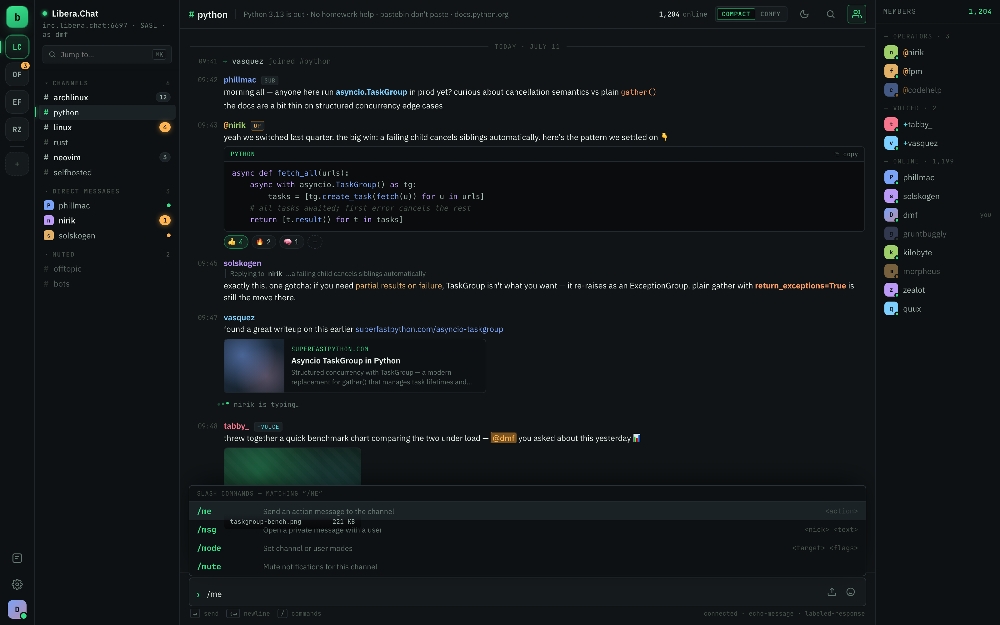
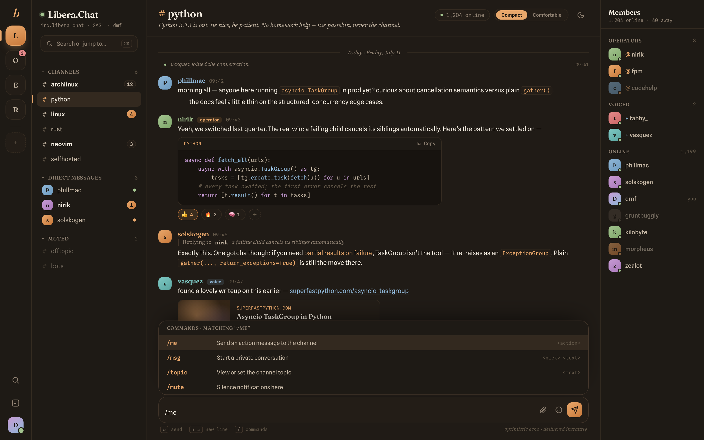
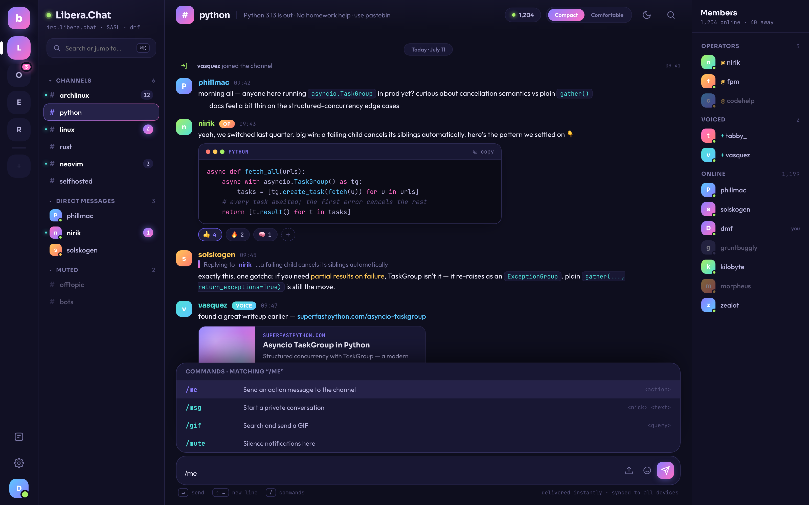
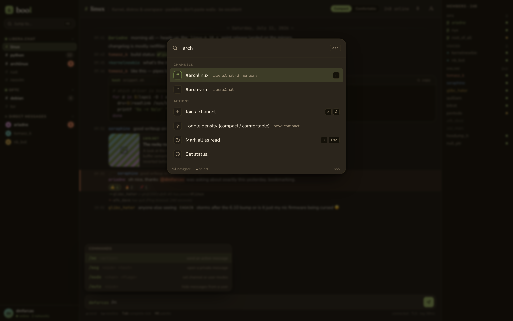
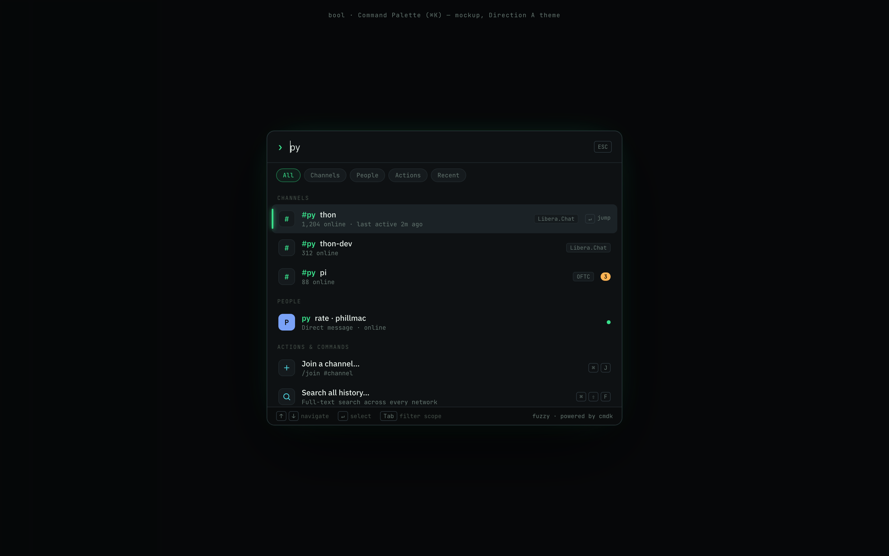
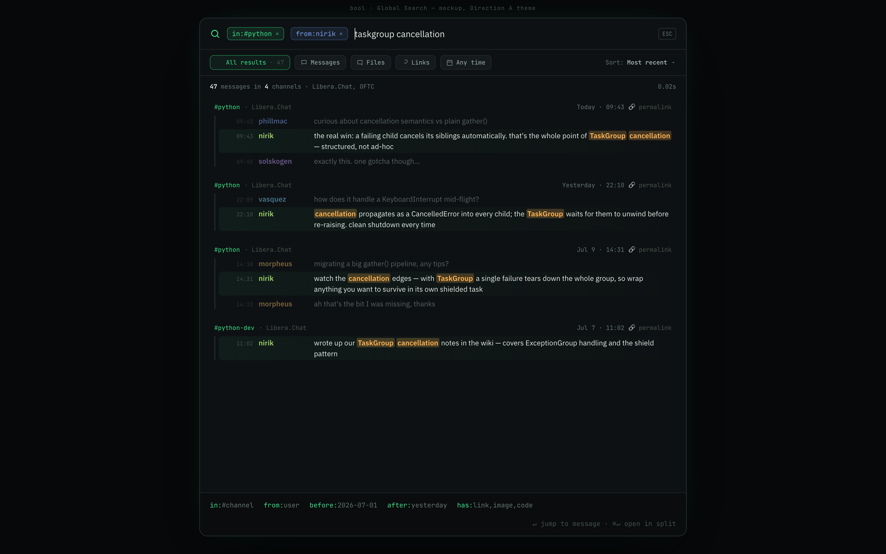

<div align="center">

<h1>bool</h1>

<p><strong>A modern, self-hosted web IRC client — the open-source <em>IRCCloud</em>.</strong></p>

<p>Working iOS push · Slack-grade full-text search · impeccable, dense design.<br/>
IRC, but it finally feels like 2026.</p>

<p>
  <a href="https://dmfarcas.github.io/bool/"><strong>🌐 Live preview</strong></a> ·
  <a href="#-roadmap"><strong>🗺️ Roadmap</strong></a> ·
  <a href="https://github.com/sponsors/dmfarcas"><strong>☕ Sponsor</strong></a>
</p>

<p>
  
  
  
  
  
</p>

</div>

> [!WARNING]
> **🚧 Early-stage — building in public.** The engine works today: multi-user
> auth and a full server-side IRC bouncer with encrypted credentials and 59
> passing tests. The end-user chat UI is the **next** milestone. bool is **not
> yet** something you can host as a daily driver — but the foundation is real
> and the design is done. Star it and follow along. ⭐

---

## Why bool?

Self-hosting your IRC life today means [The Lounge](https://thelounge.chat/) — a
great project that loses people on three specific things. bool is aimed
squarely at those:

| The pain | bool's answer |
| --- | --- |
| 📵 **No real iOS push** | An always-on bouncer + PWA built for **working push notifications** on iOS, not just desktop. |
| 🔍 **Weak search** | **Slack-grade full-text search** (SQLite FTS5) over your entire history, with `in:` / `from:` / `has:` filters. |
| 😖 **Wastes space / CSS-hacking for density** | **Compact-by-default** with a real, one-click density toggle. Density is a first-class feature, not a hack. |

Add a **Cmd-K command palette**, self-documenting slash commands, rich media,
reactions/replies/typing (with graceful IRC degradation), and a genuinely
beautiful multi-theme interface — and IRC starts to feel like a premium modern
chat app, while staying 100% yours.

**Positioning:** an open-source IRCCloud for self-hosted communities — one admin
hosts many users, with per-user isolation (think soju, but web-first and pretty).

## 🎨 Design preview

Design/UX quality is the **#1 priority** of this project, so it came first. These
are interactive mockups (dark + light, live density toggle) — the shipping UI is
Milestone 5. Explore them all on the **[live preview site](https://dmfarcas.github.io/bool/)**.

<div align="center">

| Terminal-Modern *(default)* | Soft-Editorial |
| :---: | :---: |
|  |  |
| **Neo-Aurora** | **Shimmer** |
|  |  |
| **Cmd-K command palette** | **Global search** |
|  |  |

<sub>Mockups, not shipping UI. One component system, multiple first-party skins — driven by CSS variables.</sub>

</div>

## ✨ Features

**Working today** ✅

- 🔐 Multi-user auth (username + password, sessions, admin panel) via
  [Better Auth](https://www.better-auth.com/)
- 📡 Server-side IRC bouncer — IRCv3 caps, SASL, `echo-message`, auto-reconnect
  (built on [irc-framework](https://github.com/kiwiirc/irc-framework))
- 🔒 SASL/network credentials **encrypted at rest** (AES-256-GCM)
- 🧵 Session-gated typed WebSocket protocol (types + zod, shared client/server)
- 🧪 59 passing tests, per-worker DB isolation, clean typecheck

**On the roadmap** 🔜

- 🗄️ Persistent history + **full-text search** (SQLite FTS5)
- 📱 **iOS push** via installable PWA
- 💬 Full chat UI — the four themes above, Cmd-K palette, slash commands
- 🖼️ Rich media, reactions, replies, typing indicators
- 🔁 Multi-device sync + read-state
- 🖥️ Optional Electron desktop wrapper

## 🏗️ Architecture

bool is a **pnpm workspace monorepo**. It is a stateful, always-on, private
real-time app — deliberately **not** Next.js.

```
packages/
  shared/   Typed WebSocket protocol — TypeScript types + zod schemas
  server/   Fastify always-on bouncer — Better Auth · IRC engine · WS gateway · SQLite
  client/   Vite + React 19 SPA / PWA — typed WS client, auth UI
```

**Stack:** TypeScript · React 19 + Vite (PWA) · Fastify · irc-framework ·
better-sqlite3 + FTS5 · Better Auth · Zustand · react-virtuoso.

## 🚀 Quick start

> Requires **Node ≥ 20** and **pnpm**. This runs the current dev build (engine +
> auth UI); there's no full chat UI yet.

```bash
git clone https://github.com/dmfarcas/bool.git
cd bool
pnpm install
pnpm dev          # server + client in parallel
```

Other scripts:

```bash
pnpm -r test      # all package tests
pnpm typecheck    # typecheck the whole workspace
pnpm --filter @bool/server db:migrate   # run migrations manually
```

The server runs migrations automatically before starting, so a fresh deploy
needs no manual DB step.

## 🗺️ Roadmap

Built milestone by milestone, each with its own design spec + plan (see `docs/`).

- [x] **M0** — Foundation (monorepo, shared protocol, WS skeleton)
- [x] **M1** — Auth + admin (Better Auth, sessions, session-gated WS)
- [x] **M2** — IRC engine (bouncer core, IRCv3/SASL, encrypted secrets)
- [ ] **M3** — History + full-text search (FTS5, retention)
- [ ] **M4** — Sync gateway + read-state (multi-device fan-out)
- [ ] **M5** — Client UI core (the themes above, Cmd-K palette)
- [ ] **M6** — Rich features (media, reactions, replies, typing)
- [ ] **M7** — Push / PWA (working iOS push)
- [ ] **M8** — Electron desktop wrapper

## 🤝 Contributing

Contributions, ideas, and bug reports are very welcome — see
[CONTRIBUTING.md](CONTRIBUTING.md). Big changes? Open an issue first so we can
align on approach.

## 🔒 Security

bool is designed to be internet-facing and multi-user, so security is a
first-class goal (scrypt/argon2id, encrypted secrets, TLS/wss, per-user
isolation, SSRF guards). Please report vulnerabilities privately — see
[SECURITY.md](SECURITY.md).

## ☕ Support

bool is free and MIT-licensed. If you'd like to help it get built, you can
[**sponsor the project on GitHub**](https://github.com/sponsors/dmfarcas) — every
bit of support (and every ⭐) genuinely helps.

## 📄 License

[MIT](LICENSE) © 2026 Dan Farcaș
